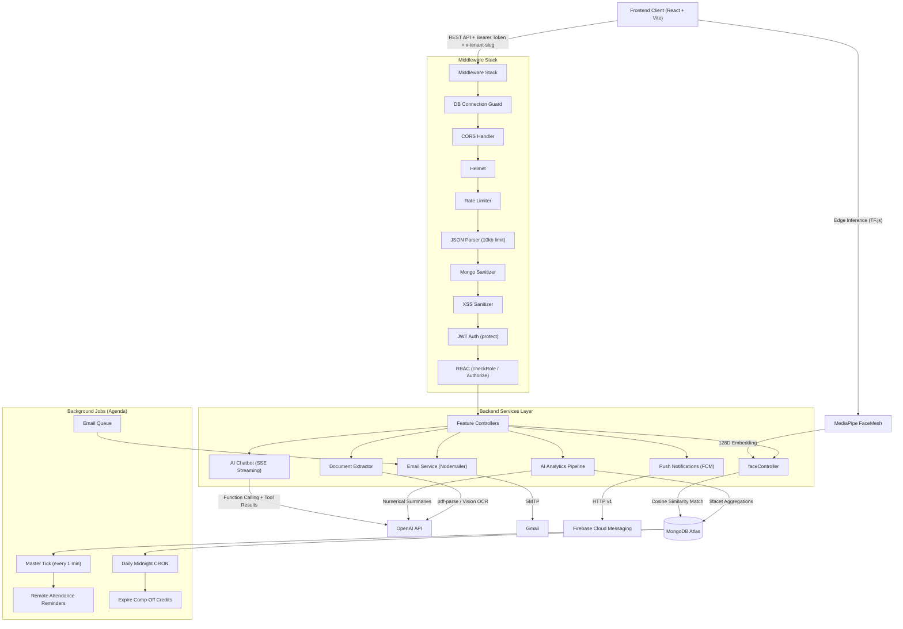

# HRMS System & AI Architecture — Technical Reference

> **Last Updated:** 2026-04-21
> **Codebase Version:** HRMS_backend v1.0.0 · HRMS_Frontend v0.0.0
> **Repository:** `Maitrii-Infotech/HRMS_backend` · `Maitrii-Infotech/HRMS_Frontend`

---

## 1. System Overview

### Product Purpose

A production-grade, multi-tenant Human Resource Management System (HRMS) designed to automate core HR operations, empower employees with self-service capabilities, and provide AI-driven actionable analytics. The system enforces strict organization-level data isolation via `orgId` binding and implements Role-Based Access Control (RBAC) across a **six-tier** hierarchy.

### Role Hierarchy

| Level | Role           | Scope                                                                 |
| :---: | :------------- | :-------------------------------------------------------------------- |
|   5   | `SUPER_ADMIN`  | Platform-wide — manages all organizations (no `orgId` binding)        |
|   4   | `ORG_ADMIN`    | Full access within their organization                                 |
|   3   | `HR_ADMIN`     | HR operations — optionally scoped to `SELECTED_BRANCHES`              |
|   2   | `MANAGER`      | Team-level access — scoped to their assigned branches                 |
|   1   | `EMPLOYEE`     | Self-service only — own data                                         |
|   —   | `BRANCH_QR`    | Virtual role — kiosk/QR display login for branches (no employee record)|

### AI Positioning

AI serves two distinct, isolated purposes:

1. **Assistive Intelligence Layer:** Strictly read-only, separated from primary data stores. Acts on behalf of authenticated users to query structured data, extract document info, and summarize aggregations — all without bypassing RBAC. Powered by OpenAI API (GPT-4o / GPT-4o-mini).
2. **Biometric Edge-AI:** Client-side facial recognition using TensorFlow.js + MediaPipe FaceMesh for secure, contactless attendance verification with blink-based liveness detection.

---

## 2. Technology Stack

### Backend (`HRMS_backend/`)

| Layer              | Technology                                                             |
| :----------------- | :--------------------------------------------------------------------- |
| **Runtime**        | Node.js + Express 5                                                    |
| **Database**       | MongoDB Atlas (Mongoose 9 ORM)                                         |
| **Authentication** | JWT (jsonwebtoken) + bcryptjs password hashing                         |
| **Background Jobs**| Agenda 5 (MongoDB-backed job scheduler)                                |
| **Push Notifications** | Firebase Admin SDK (FCM)                                           |
| **Email**          | Nodemailer (Gmail SMTP)                                                |
| **AI / LLM**       | OpenAI SDK 4.x (GPT-4o / GPT-4o-mini)                                |
| **PDF Processing** | pdf-parse (text extraction) · pdf-lib (manipulation) · Puppeteer (HTML→PDF) |
| **Image Processing** | Sharp 0.34                                                           |
| **Excel Export**   | ExcelJS 4                                                              |
| **File Storage**   | AWS S3 (ap-south-1) · Cloudinary (legacy/fallback)                     |
| **Security**       | Helmet · express-rate-limit · custom Mongo sanitize · XSS sanitizer    |
| **Deployment**     | Vercel-compatible (serverless) · Local (nodemon)                       |

### Frontend (`HRMS_Frontend/`)

| Layer              | Technology                                                             |
| :----------------- | :--------------------------------------------------------------------- |
| **Framework**      | React 19 + Vite 6                                                      |
| **Routing**        | React Router DOM 7                                                     |
| **State Management** | Zustand 5 (UI store) · React Context (Auth)                         |
| **Server State**   | TanStack React Query 5                                                 |
| **Styling**        | Tailwind CSS 3 + shadcn/ui (Radix UI primitives)                       |
| **Forms**          | React Hook Form 7 + Zod 4 validation                                  |
| **Data Tables**    | TanStack React Table 8                                                 |
| **Charts**         | Recharts 3                                                             |
| **Face Recognition** | TensorFlow.js 4 + MediaPipe FaceMesh (browser-side)                 |
| **Push (Client)**  | Firebase Web SDK 12 (FCM + VAPID)                                      |
| **HTTP Client**    | Axios (with interceptors for token refresh + tenant slug injection)     |
| **Typography**     | Geist Variable (via @fontsource)                                       |

---

## 3. Architecture Breakdown

### Data Flow Diagram



### Request Lifecycle

```
Client Request
  → DB Connection Guard (ensures MongoDB is ready — critical for Vercel cold starts)
  → CORS (dynamic origin matching: localhost, LAN IPs, *.vercel.app)
  → Helmet (security headers)
  → Rate Limiter (1000 req/15min dev · 100 req/15min prod)
  → JSON Body Parser (10kb limit)
  → Mongo Sanitizer (strips $ and . operators from input)
  → XSS Sanitizer (escapes < > in string values)
  → JWT Auth (protect middleware — resolves Employee or Branch)
  → RBAC Check (checkRole / checkMinRole / authorize)
  → Controller Logic
  → Response
```

---

## 4. Security Model

### Cross-Tenant Isolation

- **`orgId` is server-derived**, never accepted from the client. It is extracted from the authenticated `req.user` (Employee document) or resolved via `tenantResolver` middleware using the `x-tenant-slug` header.
- The `buildSecureFilter()` function in `securityContext.js` automatically injects `orgId` into every MongoDB query filter, making cross-tenant data leakage structurally impossible.
- Tenant status validation: `Suspended` or `Inactive` organizations are blocked at the middleware level with HTTP 403.

### RBAC Enforcement

| Component                | File                                  | Purpose                                                    |
| :----------------------- | :------------------------------------ | :--------------------------------------------------------- |
| `protect`                | `middleware/auth.js`                  | Verify JWT, resolve Employee or Branch (virtual BRANCH_QR) |
| `authorize(...roles)`    | `middleware/auth.js`                  | Allow only listed roles                                    |
| `checkRole(roles[])`     | `middleware/roleMiddleware.js`        | Check exact role membership                                |
| `checkMinRole(role)`     | `middleware/roleMiddleware.js`        | Check minimum hierarchy level (numeric comparison)         |
| `restrictToSelf`         | `middleware/roleMiddleware.js`        | Employees can only access their own data                   |
| `getScopedEmployeeIds()` | `services/ai/getScopedEmployeeIds.js` | Returns the set of employee IDs a user is allowed to query |
| `buildSecurityContext()` | `services/ai/securityContext.js`      | Builds a pure security context object from req.user        |
| `buildSecureFilter()`    | `services/ai/securityContext.js`      | Builds MongoDB query filters respecting role scope         |

### Authentication Flow

```
Login → JWT issued (short-lived) + HttpOnly Refresh Token (cookie)
  → Frontend stores access token in localStorage
  → Axios interceptor attaches Bearer token + x-tenant-slug header
  → On 401 → Auto-refresh via /auth/refresh endpoint (cookie-based)
  → On refresh failure → Clear localStorage, redirect to login
  → Concurrent 401s are queued and replayed after refresh
```

### Biometric Security

- **No raw images are stored or transmitted.** Only computed 128-dimensional mathematical embeddings (floating-point arrays) are persisted in the database.
- Face enrollment requires explicit `consent_given: true` from the employee.
- Enrollment records who performed it (`enrolled_by` → Employee ObjectId).

---

## 5. Feature Modules — Detailed Inventory

### 5.1 Employee Management

- **Full lifecycle:** Create → Active → Notice Period → Clearance → FNF → Relieved
- **Offboarding workflow:** 5-stage separation pipeline (`RESIGNATION_LOGGED` → `NOTICE_PERIOD` → `CLEARANCE_IN_PROGRESS` → `FNF_PENDING` → `RELIEVED`)
- **Offboarding checklist:** EXIT_INTERVIEW, IT_CLEARANCE, ACCOUNTS_CLEARANCE, ADMIN_CLEARANCE, BRANCH_CLEARANCE
- **Letter generation:** Relieving & Experience letters via Puppeteer (HTML→PDF), with e-sign support and document numbering
- **Bulk upload:** CSV import via PapaParse (frontend) with validation
- **Auto Employee ID:** Configurable prefix + auto-incrementing counter per org (`employeeIdPrefix` + `employeeIdCounter`)
- **Multi-branch support:** Employees can belong to multiple branches with one `baseBranch`

### 5.2 Attendance & Biometrics

- **Dual verification modes:** QR Code scan or Face Recognition (configurable per org via `qr_attendance_mode`)
- **QR Protocol:** Configurable as `check_in_only` or `in_out` (check-in + check-out)
- **Geo-fencing:** Optional GPS validation with configurable radius (default 50m)
- **QR rotation:** Auto-rotating QR codes at configurable intervals (default 300s / 5min)
- **Shift management:** Per-employee shift timings with MORNING/AFTERNOON/NIGHT/CUSTOM types, overnight shift support
- **Work modes:** ON_SITE, REMOTE, HYBRID — with per-employee remote days configuration
- **Late/Half-day logic:** Grace period → Late mark → Half-day threshold (all configurable per org)
- **Missing punch behavior:** Configurable as `auto_checkout`, `half_day`, or `pending`
- **Attendance approval:** Configurable approver — by role, specific user, or auto-approve
- **Remote attendance reminders:** Automated email reminders via Agenda background jobs

### 5.3 Face Recognition System

| Component | Location | Responsibility |
|:---|:---|:---|
| **Edge AI Model** | `hooks/useFaceRecognition.js` (Frontend) | TensorFlow.js + MediaPipe FaceMesh — face detection, landmark extraction, 128D embedding computation |
| **Liveness Detection** | `hooks/useFaceRecognition.js` (Frontend) | Blink detection via Eye Aspect Ratio (EAR) — prevents photo spoofing |
| **Brightness Check** | `hooks/useFaceRecognition.js` (Frontend) | Canvas-based ambient light validation (<40 = too dark) |
| **Enrollment API** | `controllers/faceController.js` | Store 128D embedding with consent metadata |
| **Verification API** | `controllers/faceController.js` | Server-side cosine similarity matching (threshold: 0.75) |
| **Module Toggle** | `Organization.modules.face_recognition` | Per-org enable/disable |
| **Face Punch Page** | `pages/FacePunch.jsx` | Dedicated kiosk-mode page for biometric attendance |

**Matching Algorithm:** Cosine Similarity (not Euclidean distance)
```
similarity = dot(A, B) / (||A|| × ||B||)
threshold = 0.75 (match) / < 0.75 (reject)
```

**Liveness Detection:** Eye Aspect Ratio (EAR) blink detection
```
EAR = distance(eye_top, eye_bottom)
BLINK_THRESHOLD = 0.008 (eyes closed)
OPEN_THRESHOLD  = 0.015 (eyes reopened)
Timeout: 4 seconds to detect a natural blink cycle
```

### 5.4 Leave Management

- **Policy-based:** Multiple leave policies per org (e.g., Earned Leave, Sick Leave, Casual Leave)
- **Balance tracking:** Per-employee leave balances with annual reset
- **Request workflow:** Apply → Pending → Approved/Rejected
- **Comp-Off system:** Holiday/weekend work credits with configurable expiry (default 60 days) and approval mode (auto/manual)

### 5.5 Payroll & Financial

- **Salary structure:** Base + DA + HRA + Conveyance + Special Allowance + Incentive + Commission
- **Statutory deductions:** EPF (employee/employer), ESI (employee/employer), Professional Tax, TDS — configurable per employee or org-wide via SalaryConfig
- **Monthly payroll execution:** Bulk salary generation with attendance-based pro-rata calculation
- **Ledger management:** Per-employee financial ledger (advances, loans, adjustments)
- **Outward payments:** Track external payments with Excel export
- **Salary slips:** Individual salary slip generation
- **Excel export:** Payroll, Ledger, and Outward Payment reports via ExcelJS

### 5.6 Branch & Department Management

- **Multi-branch architecture:** Organizations can have multiple branches with distinct locations
- **Branch QR login:** Branches can authenticate independently for kiosk/QR display mode
- **Department management:** Departments are org-scoped and linked to employees

### 5.7 Notifications

- **Push notifications:** Firebase Cloud Messaging (FCM) via Web Push with automatic token cleanup for expired/invalid tokens
- **In-app notifications:** Stored in MongoDB Notification model
- **Email notifications:** Welcome emails, remote attendance reminders

### 5.8 Organization Settings

- **Module toggles:** payroll, attendance, face_recognition, leaves, recruitment, performance, commonManager, ai
- **Statutory configuration:** Financial year start, PAN, GST, TAN
- **Attendance configuration:** Shift rules, grace periods, approval modes, geo-fencing
- **Organization types:** IT Services, Manufacturing, Retail, Logistics, Other
- **Status lifecycle:** Pending → Active → Inactive → Suspended

---

## 6. AI System Design

### 6.1 Chatbot Engine (`aiController.js`)

- **Architecture:** Multi-turn conversational assistant using OpenAI's function calling (tool use)
- **Streaming:** Real-time Server-Sent Events (SSE) for character-by-character response delivery
- **Role-Based Tool Injection:** Tools are dynamically selected based on `ctx.role`:

| Role         | Available Tools                                                                                             |
| :----------- | :---------------------------------------------------------------------------------------------------------- |
| `EMPLOYEE`   | `get_own_today_attendance`, `get_own_attendance`, `get_own_leaves`, `get_own_salary_slip`, `get_own_profile` |
| `MANAGER`    | All employee tools + `get_today_attendance`, `get_team_list`, `get_team_attendance`, `get_team_leaves`       |
| `HR_ADMIN`   | All manager tools + `get_employee_list`, `get_attendance_summary`, `get_leave_requests`, `get_branch_overview` |
| `ORG_ADMIN`  | All HR tools + `get_payroll_summary`, `get_headcount_analytics`                                             |
| `SUPER_ADMIN`| Same as ORG_ADMIN                                                                                           |

- **Security:** All tool executions are scoped via `buildSecureFilter()` — tools can only access data the user's role permits. Audit logs tracked in `AIAuditLog` model.

### 6.2 Document Extraction Pipeline (`documentExtractor.js`)

- **Hybrid parsing strategy:**
  1. Attempt native text layer extraction via `pdf-parse`
  2. If text is insufficient (<100 chars), fall back to image conversion via Sharp → send as `image/jpeg` to GPT-4o Vision
- **Schema mapping:** Enforces `response_format: { type: "json_object" }` to produce structured output that maps directly to HRMS Employee schema fields
- **Use cases:** Resume parsing, Aadhaar extraction, PAN card OCR

### 6.3 Analytics Pipeline (`aiAnalyticsController.js` + `analyticsAggregator.js`)

- **Parallel fetching:** DB operations execute concurrently via `Promise.all` using native MongoDB `$facet` aggregations
- **LLM decoupling:** LLMs are fed purely numerical, pre-aggregated structs for token-efficient summarization
- **Caching:** In-memory `Map`-based cache (`insightsCache.js`) with intelligent TTL:
  - Current month: 10 minutes (live data)
  - Historical months: 12 hours (immutable data)
  - Cache key: `insights:{orgId}:{userId}:{role}:{month}:{year}` (ensures tenant + user + role isolation)
  - Auto-cleanup every 30 minutes via `setInterval().unref()`

### 6.4 AI Audit Logging (`AIAuditLog` model)

- Tracks every AI interaction: user, org, action type, token usage, model used
- Enables cost tracking and compliance auditing per organization

---

## 7. Background Jobs System (Agenda)

The system uses **Agenda** (MongoDB-backed job scheduler) for all background processing, replacing any need for Redis/BullMQ.

| Job Name | Schedule | Description |
|:---|:---|:---|
| `attendance-reminder-master-tick` | Every 1 minute | Scans all orgs for remote/hybrid employees whose shift is starting soon, enqueues individual email jobs |
| `send-remote-attendance-reminder-email` | On-demand (queued) | Sends individual attendance reminder emails via Nodemailer |
| `expire-comp-off-credits` | Daily at midnight (`0 0 * * *`) | Scans and expires comp-off credits past their expiry date |

**Configuration:** `config/agenda.js` — connects to MongoDB `agendaJobs` collection, processes every 30 seconds, max 20 concurrent jobs.

---

## 8. File & Directory Structure

### Backend (`HRMS_backend/`)

```
├── config/
│   ├── agenda.js              # Agenda job scheduler initialization
│   ├── db.js                  # MongoDB connection (serverless-safe, singleton)
│   └── firebase.js            # Firebase Admin SDK initialization
├── controllers/               # 21 controllers
│   ├── aiAnalyticsController.js
│   ├── aiController.js
│   ├── aiDocumentController.js
│   ├── attendanceController.js
│   ├── authController.js
│   ├── branchController.js
│   ├── compOffController.js
│   ├── employeeController.js
│   ├── faceController.js
│   ├── healthController.js
│   ├── holidayController.js
│   ├── leaveController.js
│   ├── ledgerController.js
│   ├── notificationController.js
│   ├── orgSettingsController.js
│   ├── outwardPaymentController.js
│   ├── qrController.js
│   ├── salaryConfigController.js
│   ├── salaryController.js
│   ├── superAdminController.js
│   └── uploadController.js
├── helper/
│   ├── ledgerExcelGenerator.js
│   ├── outwardPaymentExcelGenerator.js
│   └── payrollExcelGenerator.js
├── jobs/
│   ├── index.js               # Job definitions + scheduling
│   ├── queues/emailQueue.js
│   └── schedulers/
│       ├── attendanceReminderMasterScheduler.js
│       ├── expireCompOffCredits.js
│       └── scheduleRemoteAttendanceReminders.js
├── middleware/
│   ├── auth.js                # JWT protection + Branch QR virtual user
│   ├── roleMiddleware.js      # RBAC (checkRole, checkMinRole, restrictToSelf)
│   ├── tenantResolver.js      # x-tenant-slug → Organization resolution
│   └── uploadMiddleware.js    # Multer file upload handling
├── models/                    # 18 Mongoose models
│   ├── AIAuditLog.js, AIInsight.js
│   ├── Attendance.js, Branch.js, CompOffRequest.js
│   ├── Department.js, Employee.js
│   ├── GraceAdjustment.js, GraceAuditLog.js
│   ├── HolidayConfig.js
│   ├── LeaveBalance.js, LeavePolicy.js, LeaveRequest.js
│   ├── Notification.js, Organization.js
│   ├── PayrollHistory.js, Salary.js, SalaryConfig.js
├── routes/                    # 18 route files
├── services/
│   ├── ai/
│   │   ├── analyticsAggregator.js   # MongoDB $facet aggregation pipelines
│   │   ├── documentExtractor.js     # PDF text + Vision OCR hybrid
│   │   ├── getScopedEmployeeIds.js  # RBAC-scoped employee ID resolution
│   │   ├── hrTools.js               # AI chatbot tool implementations
│   │   ├── insightsCache.js         # In-memory TTL cache
│   │   ├── openaiClient.js          # Shared OpenAI singleton
│   │   └── securityContext.js       # Security context builder + tool sets
│   ├── emailService.js              # Welcome + attendance reminder emails
│   └── fcmService.js                # Firebase push notification helper
├── utils/
│   ├── authUtils.js
│   └── geoUtils.js                  # GPS distance calculations
├── server.js                        # Express app + startup orchestration
└── vercel.json                      # Vercel deployment config
```

### Frontend (`HRMS_Frontend/`)

```
├── src/
│   ├── api.js                 # Axios instance with interceptors (auth, tenant, refresh)
│   ├── firebase.js            # Firebase client SDK init + FCM token handling
│   ├── App.jsx                # Route definitions (14 routes)
│   ├── main.jsx               # React root + QueryClientProvider
│   ├── components/
│   │   ├── Login.jsx
│   │   ├── Sidebar.jsx
│   │   ├── AIAssistant.jsx           # Chatbot UI with SSE streaming
│   │   ├── AIDocumentExtractor.jsx   # Document upload + field extraction
│   │   ├── AIInsightsPanel.jsx       # Analytics dashboard with cached insights
│   │   ├── AddEmployeeModal.jsx, EditEmployeeModal.jsx
│   │   ├── BranchList.jsx, BranchManager.jsx, BranchViewModal.jsx
│   │   ├── BulkUploadModal.jsx       # CSV bulk employee import
│   │   ├── CreateOrganizationModal.jsx
│   │   ├── DashboardStats.jsx
│   │   ├── EmployeeList.jsx
│   │   ├── RoleAssignmentModal.jsx
│   │   ├── SalarySlip.jsx
│   │   ├── attendance/, employees/, leaveManagement/, settings/
│   │   ├── shared/                   # Reusable UI primitives
│   │   └── ui/                       # shadcn/ui components
│   ├── context/AuthContext.jsx       # Auth state provider
│   ├── hooks/
│   │   ├── useDashboardStats.js      # React Query hook for dashboard data
│   │   ├── useFaceRecognition.js     # TF.js face detection + liveness
│   │   └── useFcm.js                 # Firebase Cloud Messaging hook
│   ├── layouts/MainLayout.jsx        # Authenticated shell (sidebar + content)
│   ├── pages/                        # 14 page components
│   │   ├── Dashboard.jsx, SuperAdminDashboard.jsx
│   │   ├── Employees.jsx, Attendance.jsx
│   │   ├── Payroll.jsx, PayrollCenter.jsx
│   │   ├── LeaveManagement.jsx, MyLeaves.jsx
│   │   ├── Settings.jsx
│   │   ├── QRScan.jsx, BranchQRDisplay.jsx, FacePunch.jsx
│   │   ├── OutwardPaymentRecord.jsx
│   │   └── remoteAttendece.jsx
│   ├── services/payrollService.js
│   └── store/uiStore.js             # Zustand UI state (sidebar, theme)
├── index.html
├── tailwind.config.js
├── vite.config.js
└── vercel.json
```

---

## 9. API Route Map

| Prefix                     | Route File              | Key Operations                                     |
| :------------------------- | :---------------------- | :------------------------------------------------- |
| `/api/v1/auth`             | `auth.js`               | Login, refresh, logout, me                         |
| `/api/v1/employees`        | `employeeRoutes.js`     | CRUD, bulk upload, profile picture, separation     |
| `/api/v1/employees`        | `faceRoutes.js`         | Face enroll, delete, status, face-punch            |
| `/api/v1/branches`         | `branchRoutes.js`       | CRUD, branch QR auth                               |
| `/api/v1/super-admin`      | `superAdminRoutes.js`   | Org management, global settings                    |
| `/api/v1/salary-config`    | `salaryConfigRoutes.js` | Statutory config (EPF, ESI, PT, TDS rates)         |
| `/api/v1/payroll`          | `salary.js`             | Generate, view, export salary slips                |
| `/api/v1/outward-payment`  | `outwardPaymentRoutes.js` | External payment tracking                        |
| `/api/v1/ledger`           | `ledgerRoutes.js`       | Employee financial ledger                          |
| `/api/v1/qr`               | `qrRoutes.js`           | QR generation, rotation, scan verification         |
| `/api/v1/attendance`       | `attendance.js`         | Clock in/out, approval, history, remote attendance |
| `/api/v1/leaves`           | `leaveRoutes.js`        | Leave policies, requests, balances, comp-off       |
| `/api/v1/org/settings`     | `orgSettingsRoutes.js`  | Organization configuration                        |
| `/api/v1/files`            | `fileRoutes.js`         | File upload (S3/Cloudinary)                        |
| `/api/v1/notifications`    | `notificationRoutes.js` | Push notification management                       |
| `/api/v1/holidays`         | `holidayRoutes.js`      | Holiday calendar management                        |
| `/api/v1/ai`               | `aiRoutes.js`           | Chatbot (SSE), analytics insights                  |
| `/api/v1/ai`               | `aiDocumentRoutes.js`   | Document extraction                                |
| `/api/v1/health`           | Direct in `server.js`   | System health check (protected)                    |
| `/api/v1/isokey`           | Direct in `server.js`   | Public uptime probe                                |

---

## 10. Database Models — Schema Summary

| Model              | Key Fields                                                                      | Indexes                              |
| :----------------- | :------------------------------------------------------------------------------ | :----------------------------------- |
| `Employee`         | orgId, personal, contact, professional (role, branches), payroll, shift_timings, separation, face_recognition | `{orgId, professional.employeeId}` unique sparse |
| `Organization`     | slug (unique), modules, shift_rules, comp_off_rules, qr_attendance_mode, attendance_approver, bankDetails | `{slug, status}` compound            |
| `Branch`           | orgId, name, location, coordinates                                              | orgId                                |
| `Department`       | orgId, name                                                                     | orgId                                |
| `Attendance`       | orgId, employeeId, date, punchIn/Out, status, verification_method, approval_status | orgId + employeeId + date           |
| `LeavePolicy`      | orgId, leaveType, allowance, carryForward                                       | orgId (synced indexes)               |
| `LeaveRequest`     | orgId, employeeId, leaveType, dates, status                                     | orgId + employeeId                   |
| `LeaveBalance`     | orgId, employeeId, year, balances                                               | orgId + employeeId + year            |
| `Salary`           | orgId, employeeId, month, year, earnings, deductions, netPay                    | orgId + employeeId + month + year    |
| `SalaryConfig`     | orgId, epf/esi/pt/tds rates and thresholds                                     | orgId                                |
| `PayrollHistory`   | orgId, month, year, metadata                                                    | orgId + month + year                 |
| `Notification`     | orgId, userId, title, body, read                                                | userId                               |
| `HolidayConfig`    | orgId, holidays (date, name, type)                                              | orgId                                |
| `CompOffRequest`   | orgId, employeeId, workedDate, status, expiryDate                               | orgId + employeeId                   |
| `GraceAdjustment`  | orgId, employeeId, month, adjustments                                           | orgId + employeeId                   |
| `GraceAuditLog`    | orgId, employeeId, action, performedBy                                          | orgId                                |
| `AIAuditLog`       | orgId, userId, action, model, tokens                                            | orgId + userId                       |
| `AIInsight`        | orgId, month, year, metrics, summary                                            | orgId + month + year                 |

---

## 11. Frontend Application Routes

| Path              | Component                | Access                              |
| :---------------- | :----------------------- | :---------------------------------- |
| `/`               | `Login`                  | Public                              |
| `/dashboard`      | `Dashboard`              | All authenticated roles             |
| `/employees`      | `Employees`              | HR_ADMIN+                           |
| `/payroll`        | `Payroll`                | ORG_ADMIN+                          |
| `/outward-payments` | `OutwardPaymentRecord` | ORG_ADMIN+                          |
| `/attendance`     | `Attendance`             | All authenticated roles             |
| `/settings`       | `Settings`               | ORG_ADMIN+                          |
| `/leaves`         | `LeaveManagement`        | Protected (token required)          |
| `/my-leaves`      | `MyLeaves`               | All employees                       |
| `/super-admin`    | `SuperAdminDashboard`    | SUPER_ADMIN only                    |
| `/scan/:token`    | `QRScan`                 | Public (token-validated)            |
| `/branch-qr`      | `BranchQRDisplay`        | BRANCH_QR role only                 |
| `/face-punch`     | `FacePunch`              | BRANCH_QR role only                 |
| `*`               | Redirect to `/`          | Catch-all                           |

---

## 12. Environment Configuration

### Backend (`.env`)

| Variable                    | Purpose                                              |
| :-------------------------- | :--------------------------------------------------- |
| `PORT`                      | Server port (default: 9999)                          |
| `MONGO_URI`                 | MongoDB Atlas connection string                      |
| `JWT_SECRET`                | JWT signing secret                                   |
| `FRONTEND_URL`              | Allowed CORS origin for frontend                     |
| `FIREBASE_PROJECT_ID`       | Firebase Admin — project identifier                  |
| `FIREBASE_CLIENT_EMAIL`     | Firebase Admin — service account email               |
| `FIREBASE_PRIVATE_KEY`      | Firebase Admin — RSA private key (PEM)               |
| `AWS_REGION`                | S3 region (ap-south-1)                               |
| `AWS_ACCESS_KEY_ID`         | S3 access key                                        |
| `AWS_SECRET_ACCESS_KEY`     | S3 secret key                                        |
| `OPENAI_API_KEY`            | OpenAI API key (for AI features)                     |
| `SMTP_USER` / `SMTP_PASS`  | Gmail SMTP credentials (for email service)           |

### Frontend (`.env`)

| Variable                          | Purpose                                         |
| :-------------------------------- | :---------------------------------------------- |
| `VITE_API_URL`                    | Backend API base URL (use LAN IP for mobile QR) |
| `VITE_FIREBASE_API_KEY`           | Firebase Web SDK — API key                      |
| `VITE_FIREBASE_AUTH_DOMAIN`       | Firebase Web SDK — auth domain                  |
| `VITE_FIREBASE_PROJECT_ID`        | Firebase Web SDK — project ID                   |
| `VITE_FIREBASE_STORAGE_BUCKET`    | Firebase Web SDK — storage bucket               |
| `VITE_FIREBASE_MESSAGING_SENDER_ID` | Firebase Web SDK — messaging sender ID       |
| `VITE_FIREBASE_APP_ID`           | Firebase Web SDK — app ID                        |
| `VITE_FIREBASE_VAPID_KEY`        | Firebase Web Push — VAPID public key             |

---

## 13. Risk Analysis & Mitigations

| Category | Risk | Impact | Current Mitigation | Recommended Enhancement |
|:---|:---|:---|:---|:---|
| **Biometrics** | Presentation Attacks | Photo spoofing for clocking in | ✅ Blink detection (EAR-based liveness) already implemented | Add temporal consistency checks + depth analysis |
| **Biometrics** | Low-light Failures | Face not detected in dark environments | ✅ Brightness check (<40 threshold) already implemented | Auto-adjust via canvas filters before inference |
| **Biometrics** | Mobile Performance | Low-end devices choking on WebGL inference | Model loaded lazily via dynamic `import()` | Offload to Web Worker + fallback to QR if FPS drops |
| **Scalability** | In-Memory Cache | Unpredictable behavior in multi-instance deployment | ✅ TTL-based Map cache with cleanup | Migrate to Redis for distributed environments |
| **Cost** | Vision OCR Tokens | High-res PDFs → thousands of input tokens | Sharp downsizing before Vision submission | Hard limit on document pages (1–3) |
| **Cost** | LLM Rate Limits | Bulk org onboarding → OpenAI RPM limits | None | Implement exponential backoff + async queue |
| **Data** | FRONTEND_URL Mismatch | `.env` has `http://localhost:517` (truncated) | Dynamic CORS regex allows LAN IPs | Fix `.env` value to `http://localhost:5173` |
| **Security** | JWT in localStorage | XSS attack could steal tokens | HttpOnly refresh token as backup | Consider moving access token to HttpOnly cookie |

---

## 14. Strategic Roadmap

### Phase 1: Harden & Stabilize (0–2 Months)

- [ ] Fix `FRONTEND_URL` in backend `.env` (`517` → `5173`)
- [ ] Migrate insights cache from in-memory `Map` to Redis for multi-instance support
- [ ] Implement Web Worker offloading for TensorFlow.js model inference
- [ ] Add OpenAI prompt caching blocks for system prompts (50% input token savings)
- [ ] Add structured error boundaries in React for graceful AI failure handling

### Phase 2: RAG & Proactive Operations (3–6 Months)

- [ ] Integrate MongoDB Atlas Vector Search for employee handbook / policy Q&A
- [ ] Add predictive attendance alerts — nightly cron flags "At-Risk" employees
- [ ] Implement anti-spoofing depth analysis for face verification
- [ ] Add rate-limited retry queue for OpenAI API calls during bulk operations
- [ ] Build notification preferences UI for fine-grained push/email control

### Phase 3: Autonomous HR Agent (6+ Months)

- [ ] Evolve AI from read-only (assistive) to write-capable (approval-gated workflows)
- [ ] Build "AI Actions Approval" dashboard for HR_ADMINs to review agentic requests
- [ ] Auto-generate leave applications, warning letters, and performance summaries
- [ ] Multi-language support for chatbot responses (Hindi, regional languages)

---

## 15. Known Issues & Technical Debt

| Issue | Severity | Location | Notes |
|:---|:---|:---|:---|
| `FRONTEND_URL` is `http://localhost:517` (truncated) | Medium | `HRMS_backend/.env:4` | Should be `http://localhost:5173` — works due to dynamic CORS regex |
| `@tensorflow/tfjs` missing from `node_modules` | High | `HRMS_Frontend/` | Need to run `npm install` after cloning — not committed to git |
| `face-api.js` referenced in old docs but not used | Low | Documentation only | Actual implementation uses TensorFlow.js + MediaPipe FaceMesh |
| `remoteAttendece.jsx` has typo in filename | Low | `HRMS_Frontend/src/pages/` | Should be `remoteAttendance.jsx` |
| `cloudinary` dependency exists but primary storage is S3 | Low | `HRMS_backend/package.json` | Clarify if Cloudinary is still needed or can be removed |
| In-memory cache resets on server restart | Medium | `services/ai/insightsCache.js` | Acceptable for single-instance; needs Redis for scaling |
| No OPENAI_API_KEY in current `.env` | Info | `HRMS_backend/.env` | AI features will fail silently without this key |
